# ENERGY FLOW X (EFX): Engineering Calculation Suite

[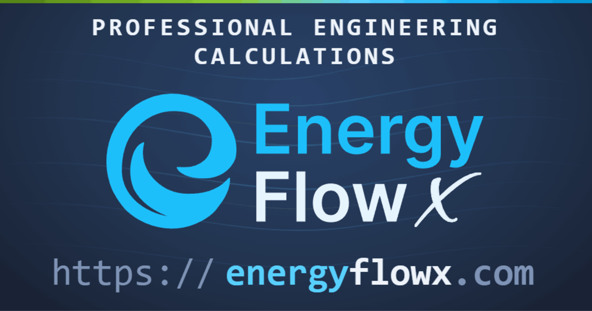](https://energyflowx.com)

> **Professional engineering calculations. From first principles to final numbers.**
> Fluid properties, HVAC processes, duct and pipe sizing, BIM in the browser and engineering tools for your AI assistant. Documented, reproducible, fast, and unit-flexible.

**EnergyFlowX** is a web platform for engineers. It computes thermophysical properties, air-handling processes and duct and pipe sizes, it opens and analyses IFC building models in the browser, and it brings the same engine into AI assistants through an MCP server and a Claude plugin. It is built for HVAC and MEP engineers, mechanical, chemical and process engineers, and the BIM coordinators and PV designers who work alongside them.

[](https://energyflowx.com) &nbsp;
[](https://energyflowx.com/mcp-server) &nbsp;
[](https://github.com/pjazdzyk/energy-flow-x-mcp)

This repository is the public showcase of EnergyFlowX: what it does today, how to reach it, and the reference comparisons you can run yourself. The product itself lives at [energyflowx.com](https://energyflowx.com).

**No fluid parameter is treated as a constant.** Density, specific heat, viscosity, conductivity and every other temperature- and pressure-dependent property is computed from IAPWS releases, published reference equations of state and peer-reviewed literature, with standards named for reference only. The reference list is at the end of this document. Results are for review by a professional engineer, who remains responsible for the design.

---

# TABLE OF CONTENTS

1. [What you can use today](#1-what-you-can-use-today)
2. [Fluid properties](#2-fluid-properties)
3. [HVAC processes](#3-hvac-processes)
4. [Duct and pipe sizing](#4-duct-and-pipe-sizing)
5. [IFC Lens, BIM in the browser](#5-ifc-lens-bim-in-the-browser)
6. [Elements, sun, PV and wind on your model](#6-elements-sun-pv-and-wind-on-your-model)
7. [EnergyFlowX in your AI assistant: the MCP server and the Claude plugin](#7-energyflowx-in-your-ai-assistant-the-mcp-server-and-the-claude-plugin)
8. [Tables, knowledge and comparisons](#8-tables-knowledge-and-comparisons)
9. [Free and member access](#9-free-and-member-access)
10. [How the numbers are made](#10-how-the-numbers-are-made)
11. [The engine room](#11-the-engine-room)
12. [Licensing, citation, and attribution](#12-licensing-citation-and-attribution)
13. [Feedback and contact](#13-feedback-and-contact)
14. [Acknowledgments](#14-acknowledgments)
15. [Reference sources](#15-reference-sources)

---

## 1. WHAT YOU CAN USE TODAY

| Area | What it gives you | Access |
|---|---|---|
| [Fluid properties](https://energyflowx.com/fluid-properties) | 29 fluids in 8 groups, plus ice: full thermodynamic and transport property sets | Free, refrigerants and brines with a free account |
| [HVAC processes](https://energyflowx.com/hvac-processes) | Air heating, air cooling with condensate, air mixing, AHU heat recovery, steam humidifier | Free, the steam humidifier with a free account |
| [Duct and pipe sizing](https://energyflowx.com/hydraulics) | Multi-criteria sizing against generic and manufacturer series, with a heatmap of the whole series | Free |
| [IFC Lens](https://energyflowx.com/ifc-lens) | An IFC model viewer that runs entirely in your browser: properties, sections, measuring, IDS, BCF | Free |
| [Elements](https://energyflowx.com/elements) | Sun hours and shadows, wind, trees and B-rep modelling on your model, measured weather and PV yield | Free, weather and PV yield with a free account |
| [MCP server](https://energyflowx.com/mcp-server) and [Claude plugin](https://github.com/pjazdzyk/energy-flow-x-mcp) | The engine inside Claude and other AI assistants: properties, sizing, air handling and network solving | Free server without an account, members server with a free account |
| [Knowledge base](https://energyflowx.com/knowledge) and [articles](https://energyflowx.com/articles) | The method, the validity range and the sources behind every calculator | Free |
| [Comparison report](https://energyflowx.com/reports/validation) | Engine output set beside published reference values, property by property | Free |

> _Amicus Plato, sed magis amica veritas._

---

## 2. FLUID PROPERTIES

Each fluid returns a full thermodynamic and transport property set, with no constant-property shortcuts. The equations of state are reference equations from the published literature, and every calculator states its validity range.

[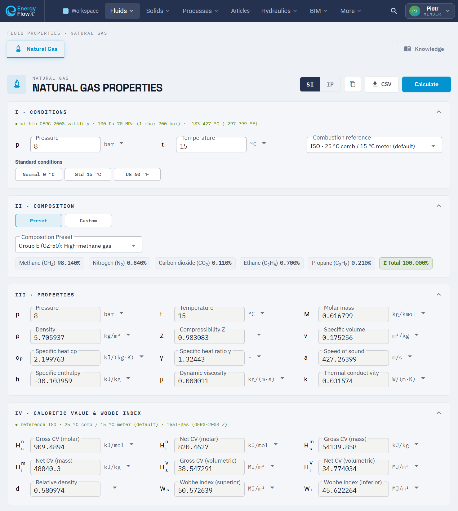](https://energyflowx.com/fluid-properties/natural-gas/natural-gas)

| Group | Fluids | Model | Access |
|---|---|---|---|
| Air | Humid air (−80 to 200 °C, 100 Pa to 5 MPa), dry air | Humid-air mixture model on IAPWS-IF97, the Lemmon dry-air equation of state and the IAPWS G11-15 virial closure | Free |
| Water and steam | Liquid water, steam | IAPWS-IF97 Regions 1 to 5 with backward equations, IAPWS R12-08 and R15-11 transport | Free |
| Natural gas | Presets or a custom blend of up to 21 components | GERG-2008, calorific value and Wobbe index following the method of ISO 6976 | Free |
| Process gases | Hydrogen, carbon dioxide (R-744), ammonia (R-717), propane (R-290), nitrous oxide | Helmholtz reference equations of state, Span-Wagner for CO₂ | Free |
| Cryogens | Nitrogen, oxygen, argon, helium (normal-fluid helium I), methane | Reference equations of state of Span et al., Schmidt-Wagner, Tegeler-Span-Wagner, Ortiz Vega et al. and Setzmann-Wagner | Free |
| Refrigerants | R-134a, R-1234ze(E), R-1234yf, R-32, R-125, and the blends R-410A, R-407C, R-454B | Helmholtz equations of state, blends as real mixtures on a multi-fluid model | Free account |
| Glycols | Ethylene glycol, propylene glycol | Aqueous-solution model, from the freezing point to 100 °C | Free |
| Brines | Calcium chloride, ethanol, methanol, potassium formate | Aqueous-solution model, from the freezing point to 40 °C | Free account |
| Solid | Ice Ih | IAPWS R10-06 Gibbs energy equation of state, with the melting and sublimation curves | Free |

Humid air covers saturation pressure, dew point and wet bulb temperatures, relative humidity, humidity ratio, enthalpy with water-mist and ice-mist components, density, specific heat, viscosity, thermal conductivity, thermal diffusivity and Prandtl number. Water and steam cover compressed liquid, superheated vapour, near-critical, two-phase and high-pressure states. The process gases, cryogens and pure refrigerants also report surface tension at the saturated interface, and concentration-dependent freezing points are built into the glycols and brines.

The validity ranges of the process gases, cryogens and refrigerants:

| Fluid | Validity |
|---|---|
| Hydrogen | −259 to 726 °C, up to 100 MPa |
| Carbon dioxide | −56 to 826 °C, up to 200 MPa (up to 0.5 MPa above 726 °C) |
| Ammonia | −77 to 406 °C, up to 50 MPa |
| Propane | −187 to 326 °C, up to 70 MPa |
| Nitrous oxide | −90 to 251 °C, up to 50 MPa |
| Nitrogen | −209 to 726 °C, up to 2200 MPa |
| Oxygen | −218 to 726 °C, up to 82 MPa |
| Argon | −189 to 426 °C, up to 1000 MPa |
| Helium | −270 to 1226 °C, up to 1000 MPa |
| Methane | −182 to 351 °C, up to 100 MPa |
| R-134a | −103 to 181 °C, up to 40 MPa |
| R-1234ze(E) | −104 to 146 °C, up to 100 MPa |
| R-1234yf | −53 to 136 °C, up to 30 MPa |
| R-32 | −136.8 to 146 °C, up to 30 MPa |
| R-125 | −43 to 166 °C, up to 20 MPa |
| R-410A, R-407C, R-454B | −73 to 146 °C, up to 35 MPa |

Refrigerant safety classes are shown with the ISO 817 designation, beside the physics.

---

## 3. HVAC PROCESSES

The process calculators use real humid-air thermodynamics, not constant-property approximations, and report the full state of every air stream involved.

- **Air Heating** (free). Solve for a given input power, a target outlet temperature or a target outlet relative humidity.
- **Air Cooling with condensate discharge** (free). The same three solving modes, plus an optional coolant-side calculation, with the condensate carried through the energy balance.
- **Air Mixing** (free). An outdoor-air inlet mixed with one to five recirculation streams.
- **AHU Heat Recovery** (free). The ε-NTU method, with effectiveness reported on the EN 308 convention. Solve from a given effectiveness, a target supply temperature or a target recovered power, for sensible or enthalpy recovery, with leakage, pressure loss, frost risk and defrost modes, and condensate tracking.
- **Steam Humidifier** `NEW` (free account). Steam demand, duty and outlet relative humidity.

---

## 4. DUCT AND PIPE SIZING

**Duct Sizing** and **Pipe Sizing** (both free) share one multi-criteria sizing engine over real fluid properties and real products.

[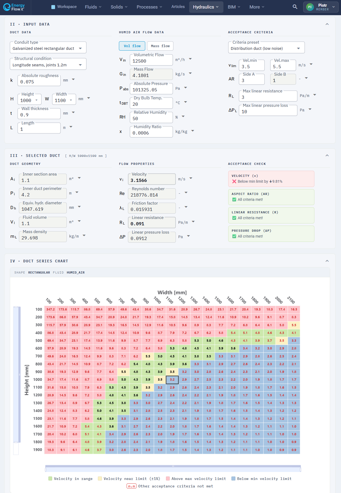](https://energyflowx.com/hydraulics/duct-sizing-calculator)

- Circular and rectangular sections, flow velocity and Reynolds number, linear pressure loss and linear resistance.
- The Colebrook-White friction factor, solved iteratively, and local losses through loss coefficients (ζ).
- The mass per metre from the construction materials and insulation layers.
- A **heatmap** that sweeps the whole dimension series at once and shows where your flow meets the acceptance criteria (velocity limits, aspect ratio, pressure-drop budget). The criteria are visible and adjustable, and the web calculators and the MCP sizing tool use the same criteria library on the server.

**Where the dimensions come from.** A Source selector in Pipe Sizing chooses the dimensions, and Generic is the default.

- **Generic series.** 11 generic series (carbon, stainless, alloy and threaded steel, steel pressure pipe by outside diameter and wall, copper for water and heating, copper for refrigeration in metric and inch, aluminium for compressed air, PP-R, PE100 gas). Each size row is a dimension that two or more independent makers print in their own catalogues. Series names follow common trade usage, and standards appear only as attribution, in the form "Listed as X by Y".
- **Manufacturer series.** 46 series from 29 manufacturers, each from one manufacturer's own catalogue: the sizes, walls, product line and designation as printed, with a link to the document and the date it was read. The sources are listed in [pipe-series-sources.md](pipe-series-sources.md). PE-X, PVC-U and CPVC are offered as manufacturer series only.
- **Duct series** follow the same rule: a size, grid or wall that a maker does not print is not offered.

EnergyFlowX is not affiliated with, sponsored by, or endorsed by these manufacturers. The values are the printed catalogue values, so check them against the current catalogue and the delivered product.

---

## 5. IFC LENS, BIM IN THE BROWSER

**IFC Lens** (free) opens Industry Foundation Classes building models, the open BIM exchange standard maintained by buildingSMART, and parses and renders them on your device with WebAssembly and WebGL. Your IFC, DXF and image files are never uploaded to a server. It reads **IFC2x3, IFC4 and IFC4x3**, STEP parts as editable solids, and GLB, glTF, OBJ and STL meshes, and several models can be overlaid as separate disciplines.

- **Structure and properties.** Browse the model by storey or by IFC class, read every property set and quantity as the file carries it, and search by expressID or GlobalId.
- **Sections and views.** Quick section planes, saved section views and a 3D box crop, standard views and an orthographic camera.
- **Colour by data.** Colour by class, storey, MEP system, property, quantity or a list of GUIDs, with reusable layers.
- **Measuring.** Distance, area, angle, volume and point coordinates, snapped to the model, in Metric or Imperial.
- **IDS and BCF.** Check a model against an IDS file, write your own specifications in the IDS Builder, and exchange issues as BCF.
- **Site and surroundings.** Place the model on the map from its georeference, drape terrain under it, and import neighbouring buildings and trees, behind an explicit opt-in.
- **Getting the work out.** Quantity takeoff to CSV, GLB, OBJ and STL export, screenshots and a viewport recorder.

[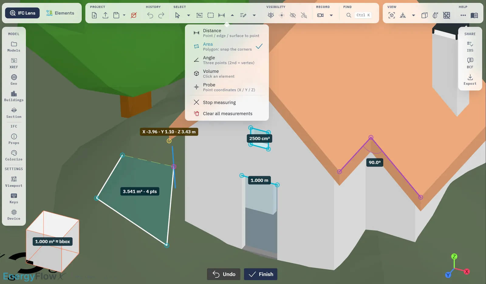](https://energyflowx.com/ifc-lens/knowledge/measuring)

[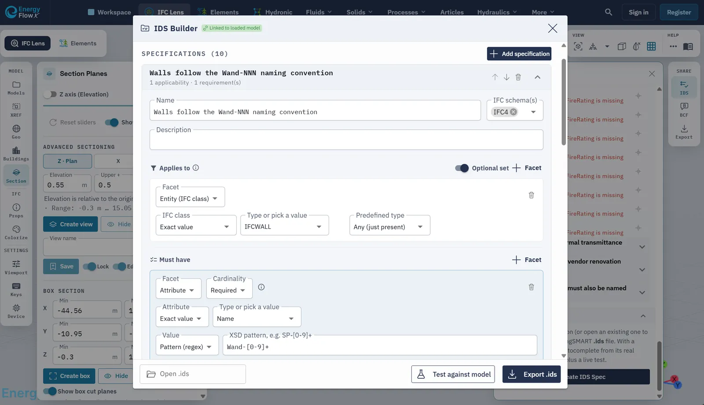](https://energyflowx.com/ifc-lens/knowledge/ids-and-bcf)

[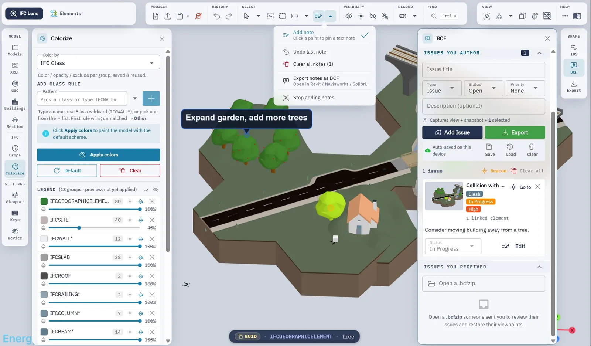](https://energyflowx.com/ifc-lens/knowledge/projects-and-notes)

The manual is published as topic pages under [`/ifc-lens/knowledge`](https://energyflowx.com/ifc-lens/knowledge) and [`/elements/knowledge`](https://energyflowx.com/elements/knowledge).

---

## 6. ELEMENTS, SUN, PV AND WIND ON YOUR MODEL

**Elements** shares the scene and the models of IFC Lens and puts the building somewhere real, on a date, under a sun and in a wind. Entry is free. Measured weather and the photovoltaic yield model need a free account and run on our server. What leaves your device is listed in the [Privacy Policy](https://energyflowx.com/legal/privacy-policy).

- **Weather** (free account). A typical meteorological year for the site from PVGIS, or your own EPW file.
- **Sun path, shadows and sun hours.** Live shadows through the day, sun hours on the ground and on building faces, an exposure score for PV siting, shade hours and an opt-in clear-sky irradiation, with values read at any point. A screening aid, not a check against any regulation.
- **Photovoltaic yield** (free account). Arrays on roofs, facades or the ground, fixed or single-axis tracking with backtracking. Plane-of-array transposition (an isotropic sky or the Perez model), shading ray-traced from the scene and charged electrically by bypass-diode group, cell temperature, inverter clipping and the loss budget, then P50 and P90, LCOE, payback, NPV and IRR, with a self-shading tilt and azimuth optimiser. A screening estimate, not an energy yield assessment.
- **Wind.** A lattice-Boltzmann flow field around the model, solved live on your GPU, with a logarithmic, a Eurocode-type or your own inlet profile. Screening for shelter and massing, not a design-grade wind study.
- **Trees.** Partial occluders with a leaf density and a seasonal crown, placed singly, in an area or along a line.
- **Modeler.** B-rep solids in the browser on an Open CASCADE Technology kernel: sketches, primitives, booleans, fillets, and STEP import as editable solids.

[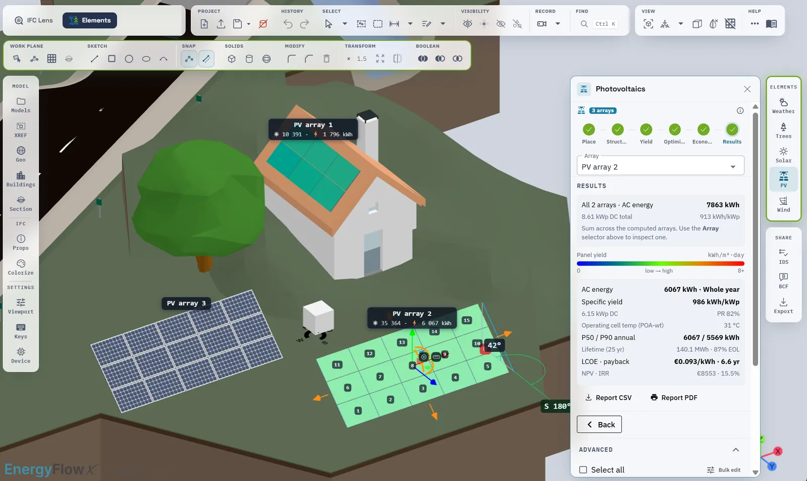](https://energyflowx.com/elements/knowledge/pv)

[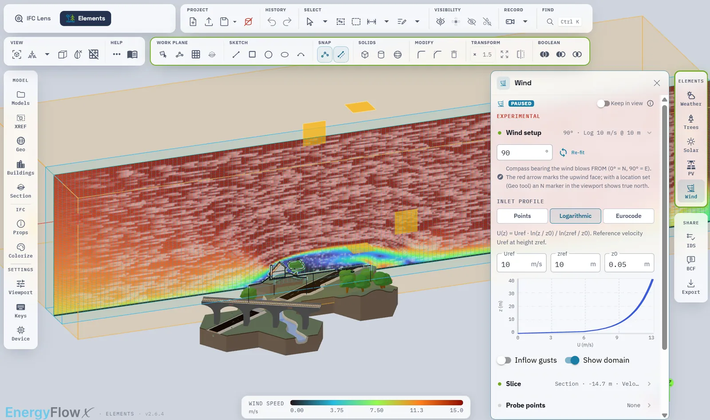](https://energyflowx.com/elements/knowledge/wind)

[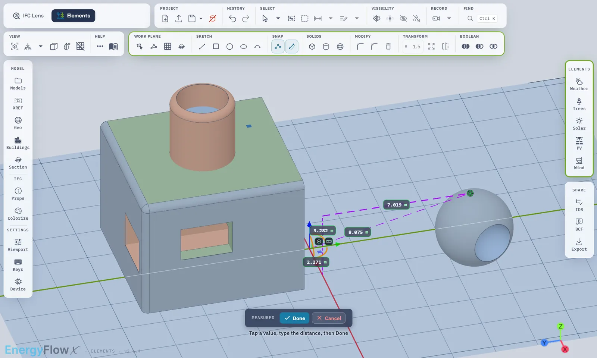](https://energyflowx.com/elements/knowledge/modeler)

The solar results are compared with published references, and the reproduction is in [reference-comparisons](reference-comparisons).

---

## 7. ENERGYFLOWX IN YOUR AI ASSISTANT: THE MCP SERVER AND THE CLAUDE PLUGIN

EnergyFlowX exposes its engine over the **Model Context Protocol**, so an AI assistant (Claude Code, Claude Desktop, Cursor, VS Code or any MCP client) calls the same engine as the website. A number then comes from the engine with its method and validity range, not from what a language model recalls. The assistant chooses the inputs and words the answer, so check both against what the tool returned.

**Two servers, connect one of them:**

| Server | Address | Account | Tools |
|---|---|---|---|
| Free | `https://energyflowx.com/energy-flow-x/mcp/free` | none | the 11 property, sizing and air-handling tools, without the members-only fluids and the steam humidifier |
| Members | `https://energyflowx.com/energy-flow-x/mcp/members` | your free account, by sign-in or an API key | all 17 tools |

**The Claude plugin.** [**energy-flow-x-mcp**](https://github.com/pjazdzyk/energy-flow-x-mcp) connects the members server and adds four skills that teach the assistant how to use the tools: which inputs matter, what to check before quoting a result, and how to hand a network over as an HTML study. You sign in once in the browser and the plugin holds no key. In Claude Code:

```shell
claude plugin marketplace add pjazdzyk/energy-flow-x-mcp
claude plugin install energyflowx@energyflowx
```

Then run `/mcp`, pick `energy-flow-x` and choose **Authenticate**. The same repository is also a Gemini CLI extension and a Codex plugin, and the skills can be downloaded one by one. The setup for every client is on [energyflowx.com/mcp-server](https://energyflowx.com/mcp-server).

**What the tools do, in plain words:**

- **Fluid properties** (`get_fluid_properties`, `get_saturation_properties`, `get_natural_gas_properties`, `get_solid_properties`, `list_fluids`). Any property at a state, saturation points, natural gas with calorific value and Wobbe index, and ice. Sweeps of several states in one call.
- **Property tables** (`get_property_table`, members server). The web calculators' tables over MCP: a range, the saturation line or a grid, up to 1000 states in one call, with a CSV link for a large table.
- **Units** (`convert_units`). Conversion, and the symbols each quantity accepts.
- **Pipes and ducts** (`search_conduit_catalog`, `get_conduit_dimensions`, `size_conduit`, `select_conduit_size`). The catalogue and its size tables, the hydraulics of one pipe or duct, and the size to choose against stated criteria: the smallest that passes, the size below and why it fails, and the size above.
- **Air handling** (`calculate_air_process`). One block or a chain of up to eight from nine blocks: heating and cooling coils, mixing, heat recovery, fan, steam humidifier (members), air-water contact, dehumidification and desiccant wheel. A target a step cannot reach is reported as not feasible.
- **Hydronic network solving** (members server: `hydronic_session`, `hydronic_edit`, `hydronic_preview`, `hydronic_solve`, `hydronic_inspect`, `hydronic_report`). Whole piped or ducted networks, rings and branches, of liquids, gases and steam, several fluids in one design, with pumps, compressors, heat exchangers, stores and receivers, steady or over time. A water network can be balanced. The report is an HTML study with a network drawing in P&ID symbols and a DXF of the drawing. **The Hydronic tools are free while in testing.** The free access can be limited or withdrawn at any time, and paid plans have no date or price.

The eleven free tools are read-only and idempotent. Inputs carry their units as strings (`"20oC"`, `"1.5bar"`, `"70degF"`) and every response names the unit it produced. Every reply carries the software and engine versions that produced it.

---

## 8. TABLES, KNOWLEDGE AND COMPARISONS

[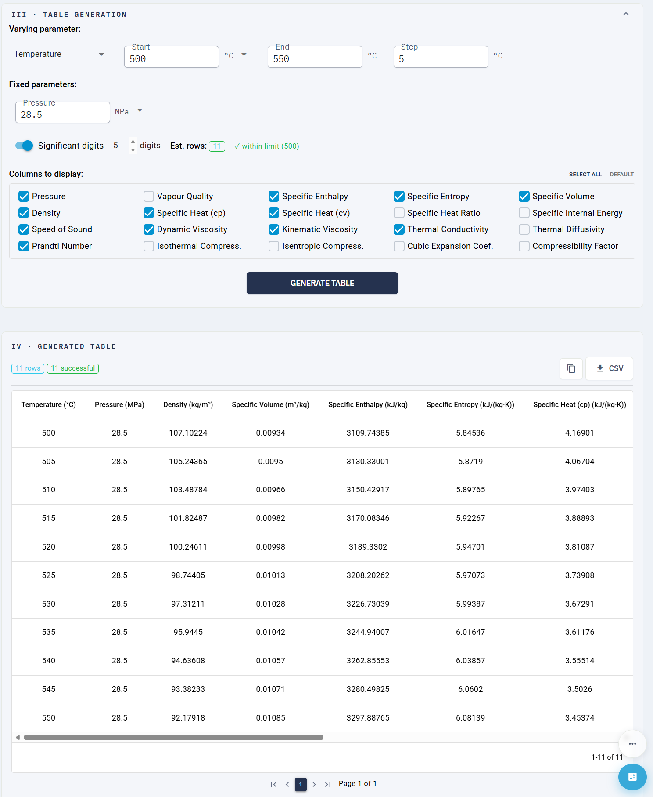](https://energyflowx.com)

- **Property tables** (free account). Any supported fluid tabulated over a varying parameter, with fixed parameters held constant, selectable columns and significant digits, exported to CSV. The 14 fluids with a vapour-liquid dome also tabulate their saturation line, by temperature or by pressure, with both phases and the latent heat on every row. A second range over a fixed input makes a grid of up to 10 tables and 500 states, exported as one CSV.
- **Knowledge base.** Every calculator has a documentation page: the physical model, how to drive the calculator, identity and safety data, validity ranges and a cited sources panel. The whole set is at [energyflowx.com/knowledge](https://energyflowx.com/knowledge), and longer pieces are at [energyflowx.com/articles](https://energyflowx.com/articles).
- **Comparison report.** The engine output is set beside published reference values, group by group, with the differences shown, at [energyflowx.com/reports/validation](https://energyflowx.com/reports/validation).
- **Reference comparisons you can run.** The solar comparisons are published in this repository with their scenes, scripts and data, in [reference-comparisons](reference-comparisons).
- **Units.** SI and Imperial throughout, with each output quantity switchable to the unit your project uses. The site works on phones as well as on wide screens.

---

## 9. FREE AND MEMBER ACCESS

Most of EnergyFlowX is free and needs no account. A free account opens the rest. Which tools are free and which need an account may change over time.

- **Free, no account:** humid and dry air, water and steam, natural gas, the process gases, the cryogens, the glycols, ice, Air Heating, Air Cooling, Air Mixing, AHU Heat Recovery, duct and pipe sizing, IFC Lens, Elements with sun, shadows, wind, trees and the Modeler, the free MCP server, the knowledge base and the comparison report.
- **Free account:** the refrigerants, the brines, the Steam Humidifier, property tables, measured weather and photovoltaic yield in Elements, and the members MCP server with the Hydronic tools.

Register at [energyflowx.com](https://energyflowx.com/registration) and explore.

---

## 10. HOW THE NUMBERS ARE MADE

Every result comes from a deterministic algorithm evaluating a published equation, not from a language model predicting a plausible value. There is no language model in the calculation path. The same inputs give the same numbers on the same version, and each calculator names the published source of its method.

- **Every result carries its version.** The MCP tools carry the software and engine versions in each reply, the REST responses carry them in headers, and a Hydronic report carries a record with the versions, the time and digests of the inputs and outputs.
- **Known issues and corrections.** [energyflowx.com/known-issues](https://energyflowx.com/known-issues) lists serious defects that are not yet fixed. A fix that changed results users may have relied on is described in [CORRECTIONS.md](CORRECTIONS.md). A single tool can be switched off with a message while a defect is open.
- **Terms.** The Terms of Use have a version that each account accepts, and a one-time professional acknowledgement is asked for before the first export of a computed result.
- **Videos.** The how-to films about EnergyFlowX use an AI-generated narration and an AI presenter. The voice imitates no real person, and every film says so on screen, in the narration and in its description.

---

## 11. THE ENGINE ROOM

EnergyFlowX runs on a family of engineering libraries written from scratch for this job, the result of years of development and well over 10,000 hours of the author's own time.

| Library | Role | Availability |
|---|---|---|
| **[Unitility](https://github.com/pjazdzyk/unitility)** | Typed physical quantities and units (`Temperature`, `Pressure`, `MassFlow` and more) with type-checked conversion. | **Open source** |
| **numenor-math** | Root-finders, line search, fixed-point iteration and sparse linear algebra. | Private |
| **eos-engine** | The fluid domain: a multiparameter Helmholtz equation-of-state kernel and one pack per fluid family. | Private |
| **flow-symphony** | A domain-generic pipe-network solver for incompressible and compressible fluids, with an energy equation through the network. | Private |
| **hvac-engine-pro** | The HVAC process engine over that fluid domain. | Private |
| **solar-engine** | Terrestrial solar and photovoltaic physics, from clear-sky irradiance to finance. | Private |

Each is plain Java with no framework dependency, so the physics stays testable and embeddable. The web front end is a Vue 3 and Quasar application, and the calculation service is a Spring Boot service with a hexagonal architecture.

---

## 12. LICENSING, CITATION, AND ATTRIBUTION

EnergyFlowX, its source code, user interface, design, text, and the compilations of data it assembles are the intellectual property of Synerset and are protected by copyright and applicable law, excluding third-party data, which stays under its own terms. Synerset claims no rights in published equations and methods.

**© 2022-2026 SYNERSET Piotr Jażdżyk. All rights reserved.** EnergyFlowX™ and Synerset™ are trademarks of *SYNERSET Piotr Jażdżyk*, based in Poland. The EnergyFlow X name with its logo is registered in Poland as a word and figurative mark, Polish Patent Office protection right no. R.387549. Any reproduction, redistribution, automated scraping or ingestion by machine-learning systems, reverse engineering, or derivation of the software, in whole or in part, without prior written permission of the rightsholder is strictly prohibited.

**How to cite.** If EnergyFlowX supports your published work, software, or a design, please cite it as:

```
Piotr Jażdżyk (2026). EnergyFlowX [Computer software]. Synerset. Retrieved from https://energyflowx.com
```

```bibtex
@misc{energyflowx,
  author       = {Piotr Jażdżyk},
  title        = {EnergyFlowX},
  howpublished = {Computer software},
  year         = {2026},
  organization = {Synerset},
  url          = {https://energyflowx.com}
}
```

**Disclaimer.** This is independent, private software developed for educational and general engineering reference. It is not an IAPWS product and has not been reviewed or endorsed by IAPWS. The thermophysical calculations use publicly available IAPWS formulations and published scientific correlations, and the implementations are the author's own interpretation of those formulations. Results are compared with published check values. **All results are for review by a professional engineer, who remains responsible for the design,** before use, and none of them is a design certification. The software is provided as-is, without warranty of any kind, and the author accepts no liability for decisions made on the basis of these calculations.

**Trademarks.** Claude, Claude Code, Claude Desktop, Gemini CLI, Codex, Cursor, Visual Studio Code, Ladybug Tools, PVGIS, pvlib, NREL, IAPWS, buildingSMART, Open CASCADE and any other product, organisation or standard named in this repository belong to their owners and are named only to describe compatibility, a comparison or an attribution. EnergyFlowX is not affiliated with, sponsored by or endorsed by them.

---

## 13. FEEDBACK AND CONTACT

This project was built by an engineer, for engineers, and feedback is welcome. Write through the contact form at [energyflowx.com/misc/social](https://energyflowx.com/misc/social), or open an issue in this repository.

When you report a bug, please include:

- **Page or functionality**, where it happened,
- **Description**, a clear and detailed account,
- **Input data**, the values used when it happened,
- **Result and expectation**, what happened and what you expected,
- **App version**, found at the bottom of the application.

---

## 14. ACKNOWLEDGMENTS

Heartfelt thanks to [Mabas83](https://github.com/mabas83) for everything. Deep gratitude to the [Silesian University of Technology](https://www.polsl.pl/en/) for the knowledge, the scientific guidance, and for shaping me into an engineer. Special thanks to [GreedyJ4ck](https://github.com/greedyj4ck) for discussions and valuable suggestions during frontend development. Big thanks to all of you.

The IAPWS attribution, with the full list of the IAPWS documents EnergyFlowX uses, opens [section 15](#15-reference-sources). EN and ISO formulations were consulted under lawful, read-only access to Polish Standards (PN, including the PN-EN and PN-EN ISO adoptions) provided to members of the Polish Chamber of Civil Engineers ([piib.org.pl](https://www.piib.org.pl/)). EnergyFlowX implements those methods in the author's own independent code and does not reproduce, redistribute, or republish the text, tables, or other protected content of any standard. Any numerical agreement with published data reflects correct physics rather than copied content. Standards are named only for reference (nominative use). EnergyFlowX is not affiliated with, certified by or endorsed by the Polish Committee for Standardization (PKN), CEN, CENELEC or ISO.

**Coefficients and data from other sources.** Methods are implemented in our own code. Some coefficient and data values come from the sources below, which carry their own terms. The full licence and notice texts are in the [NOTICE](NOTICE) file.

- **CoolProp**, Copyright 2012-2018 Ian H. Bell and other CoolProp developers, [MIT licence](https://github.com/CoolProp/CoolProp/blob/master/LICENSE). Coefficient and data values are taken from its fluid and mixture files: surface tension, refrigerant blend and helium transport, the glycol and brine solutions, terms of the carbon dioxide, ammonia and nitrous oxide models, and the refrigerant mixture parameters. No CoolProp code is used. The published works behind these values are cited in section 15.
- **NIST AGA8 reference code** ([github.com/usnistgov/AGA8](https://github.com/usnistgov/AGA8)), developed by employees of the National Institute of Standards and Technology. Works of NIST employees are not subject to copyright protection in the United States, and NIST grants permission elsewhere on the terms of its notice. The GERG-2008 coefficients and the reducing and interaction parameters come from this code and are implemented in our own code. The model is the one of Kunz and Wagner (2012), cited in section 15.
- **Sotiriadou S.G., Antoniadis K.D., Assael M.J., Martinek V., Huber M.L. (2025)**, *Correlation for the Viscosity of Methane from the Triple Point to 625 K and Pressures to 1000 MPa*, Int. J. Thermophys. 47(1), 18, [doi:10.1007/s10765-025-03690-7](https://doi.org/10.1007/s10765-025-03690-7), licensed under [CC BY 4.0](https://creativecommons.org/licenses/by/4.0/). Changes: the correlation (Eqs. 1 to 6) is implemented in our own code for the methane viscosity, with the coefficients of Tables 3 to 5 taken into it. The text and layout of the paper are not reproduced.

**Third-party open-source software.** The browser-based IFC Lens and Elements are built on the open-source [That Open Engine](https://github.com/ThatOpen/) BIM toolkit by That Open Company (MIT), the WebAssembly [web-ifc](https://github.com/ThatOpen/engine_web-ifc) parser (MPL-2.0), and **Three.js** (MIT). The Elements Modeler runs **Open CASCADE Technology**, the B-rep CAD kernel, compiled to WebAssembly and conveyed to the browser under LGPL-2.1 with the OCCT exception, by way of replicad-opencascadejs and opencascade.js (MIT build tooling).

The **IFC, IDS and BCF standards** are maintained by [buildingSMART International](https://www.buildingsmart.org/) (BCF used under CC BY-ND 4.0). The bundled demonstration model is the **PCERT Sample Scene** (IFC 4.0.2.1), © buildingSMART International, redistributed unmodified under [CC BY 4.0](https://creativecommons.org/licenses/by/4.0/). **Map data, imagery and data services.** Elements and IFC Lens use the third-party sources below, each under its own licence. The full list, with each licence, credit line and how it is used, is published in section A.4 of [energyflowx.com/third-party-notices.txt](https://energyflowx.com/third-party-notices.txt), generated from the same list as the privacy policy.

- **OpenStreetMap** map tiles, Nominatim place search, and building and tree data through the public Overpass API, © OpenStreetMap contributors, [ODbL](https://www.openstreetmap.org/copyright).
- **Overture Maps** buildings, Overture Maps Foundation, [ODbL with CC BY 4.0 components](https://docs.overturemaps.org/attribution/).
- **Terrain Tiles** by Mapzen, a Linux Foundation project, from the AWS Registry of Open Data, built from USGS, NOAA, Copernicus EU-DEM and further [national sources](https://github.com/tilezen/joerd/blob/master/docs/attribution.md), relayed by our server.
- **swissALTI3D** terrain, © swisstopo, read by our server.
- **Orthophoto** (Ortofotomapa), © Główny Urząd Geodezji i Kartografii.
- **3D BAG** buildings, © 3DBAG by tudelft3d and 3DGI, [CC BY 4.0](https://docs.3dbag.nl/en/copyright/).
- **LIDAR Composite Digital Terrain Model, 1 m**, **LIDAR Composite Digital Surface Model, 1 m** (first and last return) and the **Vegetation Object Model**, © Environment Agency copyright and/or database right 2022. All rights reserved. Used under the [Open Government Licence v3.0](https://www.nationalarchives.gov.uk/doc/open-government-licence/version/3/), read by our server for terrain, building heights, trees and the relief tiles it shades.
- **Scottish Public Sector LiDAR**, Open Government Licence v3.0, accessed from [registry.opendata.aws/scottish-lidar](https://registry.opendata.aws/scottish-lidar): National LiDAR Programme, Crown copyright Scottish Government © Crown copyright and database right (2025). Outer Hebrides 2019, © SEPA (2019). Phase 1, Crown copyright Scottish Government, SEPA and Scottish Water (2012). Orkney 2023 and phases 4 to 6, contains public sector information licensed under the Open Government Licence v3.0. Read by our server.
- **Planning data**, Ministry of Housing, Communities and Local Government, used under the [Open Government Licence v3.0](https://www.nationalarchives.gov.uk/doc/open-government-licence/version/3/), read by our server, with each dataset's own attribution shown beside its designations (for example © Historic England 2026. Contains Ordnance Survey data © Crown copyright and database right 2026).
- Coordinate-system definitions from the EPSG Geodetic Parameter Dataset (IOGP), through epsg.io.
- Bundled with our calculation service: the **OSTN15** transformation, © Copyright and database rights Ordnance Survey Limited 2016, © Crown copyright and database rights Land & Property Services 2016 and/or © Ordnance Survey Ireland, 2016, used under the [BSD Licence](https://opensource.org/licenses/bsd-license.php), **Natural Earth** 1:10m map units, public domain, for coarse coverage outlines, and the **ONS Postcode Directory**, Great Britain rows, for postcode search: Contains OS data © Crown copyright and database right 2026. Contains Royal Mail data © Royal Mail copyright and database right 2026. Source: Office for National Statistics licensed under the Open Government Licence v.3.0.
- Typical-meteorological-year weather from **PVGIS**, European Commission Joint Research Centre, fetched by our server.

The solar comparison uses the output of **Ladybug Tools**, an open-source solar library under AGPL-3.0, gratefully acknowledged. It is an offline reference: only its output data and our own figure are published here, and no Ladybug code is distributed.

---

## 15. REFERENCE SOURCES

The IAPWS list below is complete. The rest is a selection of the most important sources, not the whole library. Each calculator's documentation page states the exact standard and validity range it uses.

### IAPWS releases and guidelines

This software is based, in part, on information obtained from the International Association for the Properties of Water and Steam ([iapws.org](https://iapws.org)). Specifically, information contained in the following documents is used. EnergyFlowX is not an IAPWS product and is not an official representation of any IAPWS release or guideline. IAPWS has not reviewed or endorsed it.

**Water and steam**

- **[1]** IAPWS R7-97(2012), *Revised Release on the IAPWS Industrial Formulation 1997 for the Thermodynamic Properties of Water and Steam*. Covers Regions 1 to 5, boundary equations, backward equations, and uncertainty estimates.
- **[2]** IAPWS G5-01(2026), *Guideline on the Use of Fundamental Physical Constants and Basic Constants of Water*. CODATA 2022 constants, ITS-90 scale, VSMOW isotopic composition, and reference quantities for water substance.
- **[3]** IAPWS SR2-01(2014), *Revised Supplementary Release on Backward Equations for Pressure as a Function of Enthalpy and Entropy p(h,s) for Regions 1 and 2 of the IAPWS Industrial Formulation 1997 for the Thermodynamic Properties of Water and Steam*.
- **[4]** IAPWS SR4-04(2014), *Revised Supplementary Release on Backward Equations p(h,s) for Region 3, Equations as a Function of h and s for the Region Boundaries, and an Equation Tsat(h,s) for Region 4 of the IAPWS Industrial Formulation 1997 for the Thermodynamic Properties of Water and Steam*.
- **[5]** IAPWS SR5-05(2016), *Revised Supplementary Release on Backward Equations for Specific Volume as a Function of Pressure and Temperature v(p,T) for Region 3 of the IAPWS Industrial Formulation 1997 for the Thermodynamic Properties of Water and Steam*. 20 subregions plus 6 auxiliary subregions near the critical point.
- **[6]** IAPWS SR3-03(2014), *Revised Supplementary Release on Backward Equations for the Functions T(p,h), v(p,h), and T(p,s), v(p,s) for Region 3 of the IAPWS Industrial Formulation 1997 for the Thermodynamic Properties of Water and Steam*.
- **[7]** IAPWS R6-95(2018), *Revised Release on the IAPWS Formulation 1995 for the Thermodynamic Properties of Ordinary Water Substance for General and Scientific Use*. Fundamental Helmholtz free-energy equation with ideal-gas and residual parts.

**Transport properties and surface tension**

- **[8]** IAPWS R12-08, *Release on the IAPWS Formulation 2008 for the Viscosity of Ordinary Water Substance*.
- **[9]** IAPWS R15-11, *Release on the IAPWS Formulation 2011 for the Thermal Conductivity of Ordinary Water Substance*.
- **[10]** IAPWS R1-76(2014), *Revised Release on the Surface Tension of Ordinary Water Substance*.

**Ice Ih, solid phase**

- **[11]** IAPWS R10-06(2009), *Revised Release on the Equation of State 2006 for H₂O Ice Ih*. Gibbs energy EOS with verification values and analytical derivatives.
- **[12]** IAPWS R14-08(2011), *Revised Release on the Pressure along the Melting and Sublimation Curves of Ordinary Water Substance*. Melting pressure for ice phases Ih, III, V, VI, VII, and sublimation pressure from 50 K to the triple point.

**Humid air**

- **[13]** IAPWS G11-15, *Guideline on a Virial Equation for the Fugacity of H₂O in Humid Air*.
- **[14]** IAPWS G9-12, *Guideline on a Low-Temperature Extension of the IAPWS-95 Formulation for Water Vapor* (50 K to 130 K).
- **[15]** IAPWS G8-10, *Guideline on an Equation of State for Humid Air in Contact with Seawater and Ice, Consistent with the IAPWS Formulation 2008 for the Thermodynamic Properties of Seawater*. Its tables are used to check the humid-air model.

### Dry Air

- **[16]** Lemmon E.W., Jacobsen R.T., Penoncello S.G., Friend D.G. (2000), *Thermodynamic Properties of Air and Mixtures of Nitrogen, Argon, and Oxygen from 60 to 2000 K at Pressures to 2000 MPa*. J. Phys. Chem. Ref. Data, Vol. 29, No. 3, 331 to 385.
- **[17]** Lemmon E.W., Jacobsen R.T. (2004), *Viscosity and Thermal Conductivity Equations for Nitrogen, Oxygen, Argon, and Air*. Int. J. Thermophysics, Vol. 25, No. 1, p. 21 to 69.

### Natural Gas

- **[18]** Kunz O., Wagner W. (2012), *The GERG-2008 Wide-Range Equation of State for Natural Gases and Other Mixtures*. J. Chem. Eng. Data, Vol. 57(11), 3032 to 3091 (basis of ISO 20765-2). Underpins density, compressibility, heat capacities, and speed of sound for the Natural Gas calculator.

### Process Gases

- **[19]** Span R., Wagner W. (1996), *A New Equation of State for Carbon Dioxide Covering the Fluid Region to 1100 K and 800 MPa*. J. Phys. Chem. Ref. Data, Vol. 25(6), 1509 to 1596. One of the single-component reference models behind the Process Gases group.
- **[20]** Lemmon E.W., Span R. (2006), *Short Fundamental Equations of State for 20 Industrial Fluids*. J. Chem. Eng. Data, Vol. 51(3), 785 to 850. The equation of state used for nitrous oxide.
- **[21]** Huber M.L. (2018), NIST Interagency/Internal Report (NISTIR) 8209, August 2018, doi:10.6028/NIST.IR.8209. The extended-corresponding-states transport model behind the nitrous-oxide viscosity and thermal conductivity.
- **[22]** Mulero A., Cachadiña I., Parra M.I. (2012), *Recommended Correlations for the Surface Tension of Common Fluids*. J. Phys. Chem. Ref. Data, Vol. 41(4), 043105. Surface tension of the process gases, the cryogens and the pure refrigerants except R-1234ze(E).
- **[23]** Mulero A., Cachadiña I. (2014), J. Phys. Chem. Ref. Data, Vol. 43(2), article 023104, doi:10.1063/1.4878755. Surface tension of R-1234ze(E).
- *Citation note.* Entries [21] and [23] are cited by author, year, series, volume and DOI, which identify them exactly. Their full titles name third-party commercial software and are intentionally not reproduced here.

### Cryogens

- **[24]** Span R., Lemmon E.W., Jacobsen R.T., Wagner W., Yokozeki A. (2000), *A Reference Equation of State for the Thermodynamic Properties of Nitrogen for Temperatures from 63.151 to 1000 K and Pressures to 2200 MPa*. J. Phys. Chem. Ref. Data, Vol. 29(6), 1361 to 1433.
- **[25]** Schmidt R., Wagner W. (1985), *A New Form of the Equation of State for Pure Substances and its Application to Oxygen*. Fluid Phase Equilibria, Vol. 19(3), 175 to 200. Companion property tables in Stewart, Jacobsen and Wagner (1991), J. Phys. Chem. Ref. Data, Vol. 20(5), 917 to 1021.
- **[26]** Tegeler Ch., Span R., Wagner W. (1999), *A New Equation of State for Argon Covering the Fluid Region for Temperatures from the Melting Line to 700 K at Pressures up to 1000 MPa*. J. Phys. Chem. Ref. Data, Vol. 28(3), 779 to 850.
- **[27]** Ortiz Vega D.O., Hall K.R., Holste J.C., Harvey A.H., Lemmon E.W. (2023), *An Equation of State for the Thermodynamic Properties of Helium*. NIST Internal Report 8474. Normal-fluid helium I only, above the lambda point.
- **[28]** Setzmann U., Wagner W. (1991), *A New Equation of State and Tables of Thermodynamic Properties for Methane Covering the Range from the Melting Line to 625 K at Pressures up to 1000 MPa*. J. Phys. Chem. Ref. Data, Vol. 20(6), 1061 to 1155.

### Refrigerants

- **[29]** Tillner-Roth R., Baehr H.D. (1994), *An International Standard Formulation for the Thermodynamic Properties of R-134a*. J. Phys. Chem. Ref. Data, Vol. 23(5), 657 to 729. The foundational model of the Refrigerants group, alongside the pure-fluid and multi-fluid Helmholtz models for the remaining members and blends.
- **[30]** Lemmon E.W., Akasaka R. (2022), *An International Standard Formulation for 2,3,3,3-Tetrafluoroprop-1-ene (R1234yf) Covering Temperatures from the Triple Point Temperature to 410 K and Pressures Up to 100 MPa*. Int. J. Thermophys., Vol. 43(8), 119.
- **[31]** Bell I.H. (2023), *Mixture Model for Refrigerant Pairs R-32/1234yf, R-32/1234ze(E), R-1234ze(E)/227ea, R-1234yf/152a, and R-125/1234yf*. J. Phys. Chem. Ref. Data, Vol. 52(1), 013101. The R-32/R-1234yf binary behind R-454B.

### Secondary Working Fluids, glycols and brines

- **[32]** Melinder Å. (2010), *Properties of Secondary Working Fluids for Indirect Systems*, IIR, 2nd ed. The basis for the Glycols and Brines calculators, including concentration-dependent freezing-point limits.

### HVAC Processes and Heat Recovery

- **[33]** Jones W.P. (2001), *Air Conditioning Engineering*, 5th edition. Psychrometric processes, cooling-coil analysis (bypass and contact factors, condensate energy balance), heating, and adiabatic mixing of moist-air streams.
- **[34]** EN 308:2022, *Heat exchangers, test procedures for establishing the performance of air-to-air heat recovery components*. Named for reference only, not reproduced. The effectiveness convention is the one used for reporting.
- **[35]** EN 13053:2019, *Ventilation for buildings, air handling units, rating and performance for units, components and sections*.
- **[36]** Kostowski E. (2000), *Przepływ ciepła*, Wydawnictwo Politechniki Śląskiej, Gliwice. The ε-NTU method, flow-arrangement correlations, and capacity-rate (C*) effects used in the heat-recovery asymmetry correction.

### Hydraulics, duct and pipe flow

- **[37]** Zeghadnia L., Robert J.L., Achour B. (2019), *Explicit solutions for turbulent flow friction factor: a review, assessment and approaches classification*. Ain Shams Engineering Journal, Vol. 10(1), 243 to 252. Includes the Vatankhah explicit approximation used as the iterative solver initial guess.
- **[38]** Mitosek M. (2001), *Mechanika płynów w inżynierii i ochronie środowiska*, PWN. Reynolds number, Darcy-Weisbach pressure loss, local losses, linear resistance, and hydraulic diameter.

### Solar irradiance and photovoltaics

- **[39]** Bird R.E., Hulstrom R.L. (1981), *A Simplified Clear Sky Model for Direct and Diffuse Insolation on Horizontal Surfaces*. SERI/TR-642-761. The broadband clear-sky model behind an irradiance study that needs no weather file.
- **[40]** Perez R., Ineichen P., Seals R., Michalsky J., Stewart R. (1990), *Modeling Daylight Availability and Irradiance Components from Direct and Global Irradiance*. Solar Energy, Vol. 44(5), 271 to 289. The anisotropic sky model used for plane-of-array transposition.
- **[41]** Kasten F., Young A.T. (1989), *Revised Optical Air Mass Tables and Approximation Formula*. Applied Optics, Vol. 28(22), 4735 to 4738.
- **[42]** IEC 61215 and IEC 61724-1, named for reference only and not reproduced. Terms such as NOCT and the yield quantities (performance ratio, specific yield) are used as defined in common photovoltaic practice.
- **[43]** Dobos A.P. (2014), *PVWatts Version 5 Manual*. NREL/TP-6A20-62641. The system loss budget.
- **[44]** PVGIS, European Commission Joint Research Centre. The measured typical-meteorological-year source, and a source of clear-sky irradiation for comparison.

### Wind screening

- **[45]** EN 1991-1-4, *Eurocode 1: Actions on structures, Part 1-4: General actions, wind actions*. Named for reference only, not reproduced. The Eurocode inlet option is our own code for a mean-wind profile of that kind, with our own terrain classes. Check the National Annex for your country and your project requirement.
- **[46]** Roshko A. (1954), *On the Development of Turbulent Wakes from Vortex Streets*. NACA Report 1191. The vortex-shedding benchmark the wind solver is compared with.

### Geometry and CAD

- **[47]** Open CASCADE Technology, the B-rep CAD kernel behind the Elements Modeler, compiled to WebAssembly and used under LGPL-2.1 with the OCCT exception, via replicad-opencascadejs and opencascade.js.

---

[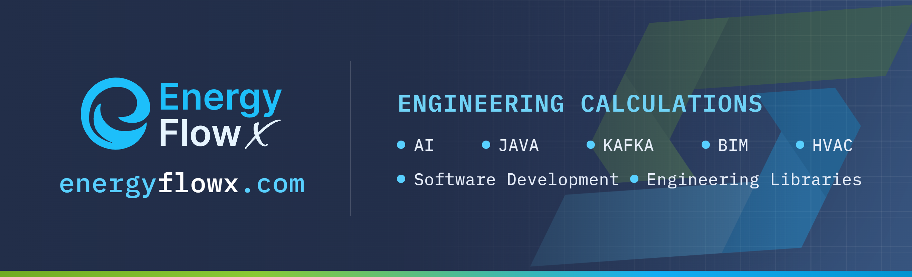](https://energyflowx.com)

**Created by Piotr Jażdżyk, MSc Eng.** [Read more about the author](https://energyflowx.com/social) · [LinkedIn](https://www.linkedin.com/in/pjazdzyk)

Do not forget to say hello.
